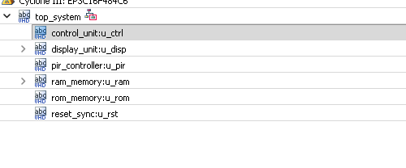
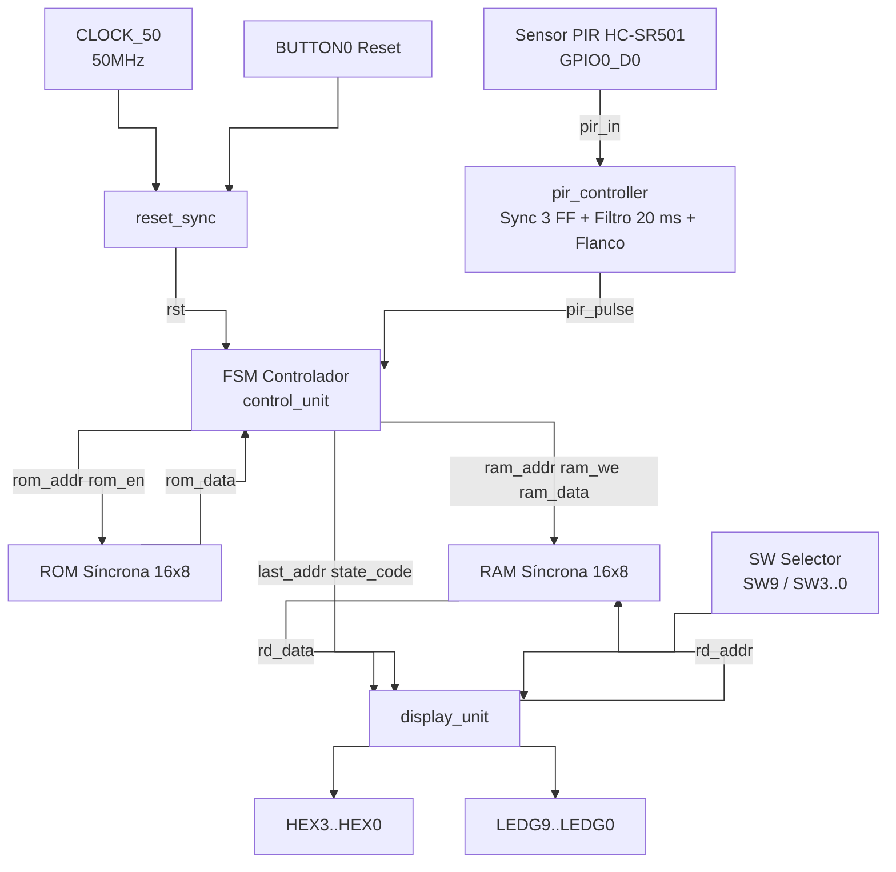
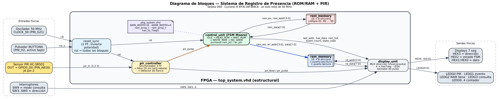
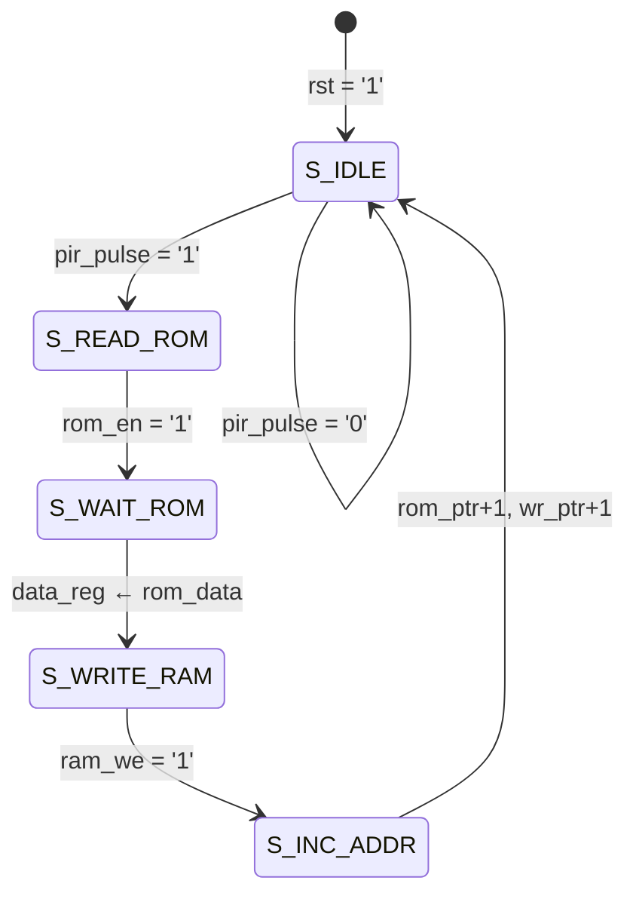
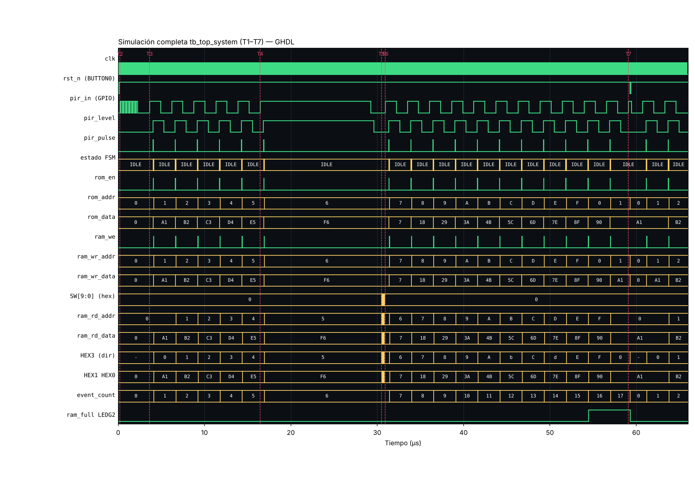
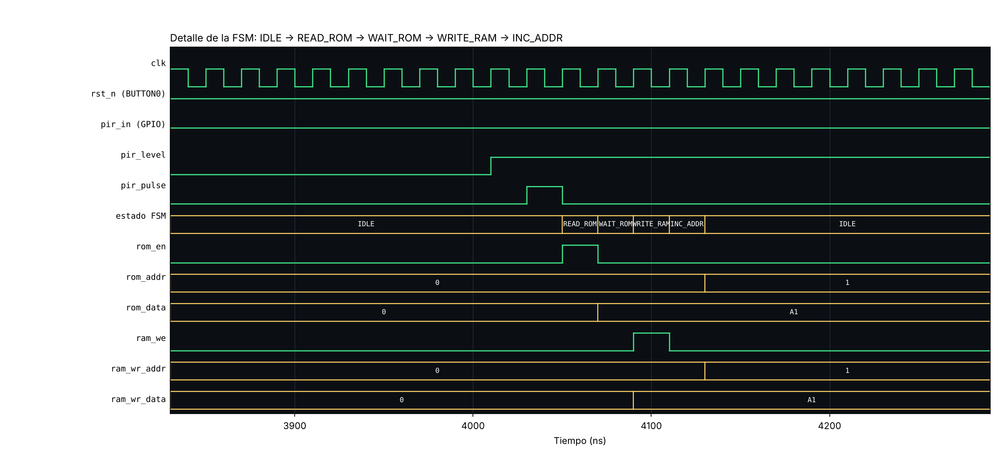
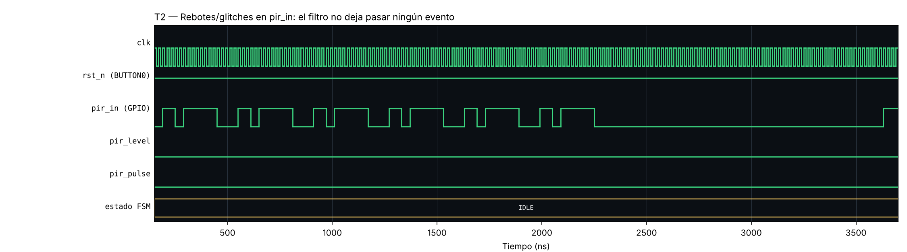
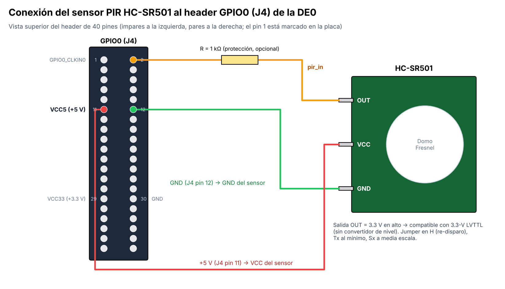

# Sistema de Registro de Presencia con Memorias ROM/RAM y Sensor PIR en VHDL

**Universidad del Cauca**  
**Autor:** Esteban Meneses (estebanmeneses-git)  
**Fecha:** Octubre 2026  
**Microproyecto 2**

---

## Descripción

Este proyecto implementa en VHDL un sistema digital que **registra eventos de presencia humana** usando un sensor **PIR HC-SR501**. Cada vez que el sensor detecta movimiento, una **máquina de estados finitos (FSM)** lee el siguiente **código de identificación** de una **memoria ROM** y lo guarda en la siguiente posición libre de una **memoria RAM**. El contenido de la RAM se muestra en los displays de 7 segmentos de la tarjeta.

El diseño es completamente modular. Tiene un paquete de constantes y tipos, un controlador que acondiciona la señal del sensor (sincronizador de 3 etapas, filtro anti-rebote y detector de flanco), memorias síncronas que Quartus implementa en bloques M9K y un testbench autoverificable con aserciones automáticas. Todo el sistema usa un único reloj de 50 MHz y no genera latches.

---

# Cumplimiento del enunciado

| Requisito | Cómo se cumple en este proyecto |
|-----------|----------------------------------|
| A1. Paquete VHDL con constantes, `DATA_WIDTH`, `ADDR_WIDTH` y tipos de memoria | [`pkg_system.vhd`](rtl/pkg_system.vhd) define `DATA_WIDTH`=8, `ADDR_WIDTH`=4, `rom_array_t`, `ram_array_t` y la función `hex_to_7seg`. |
| A2. Controlador PIR con sincronización multi-etapa y detector de flanco | [`pir_controller.vhd`](rtl/pir_controller.vhd): 3 flip-flops, filtro de 20 ms y pulso de 1 ciclo. |
| A3. FSM que espera el evento, lee la ROM, escribe la RAM e incrementa direcciones | [`control_unit.vhd`](rtl/control_unit.vhd): FSM Moore de 5 estados. |
| A4. Memoria ROM inicializada | [`rom_memory.vhd`](rtl/rom_memory.vhd): 16 códigos de evento predefinidos. |
| A5. Memoria RAM síncrona | [`ram_memory.vhd`](rtl/ram_memory.vhd): RAM de doble puerto simple 16×8 (bloque M9K). |
| A6. Top-level estructural con los pines de la Cyclone III | [`top_system.vhd`](rtl/top_system.vhd) + [`top_system.qsf`](top_system.qsf). |
| B1. Inmunidad a rebotes y ruido | Filtro por estabilidad de 20 ms (prueba T2). |
| B2. Lectura desde ROM al activarse el sensor | Estados `S_READ_ROM` y `S_WAIT_ROM` (prueba T3). |
| B3. Escritura en RAM en posiciones consecutivas | `S_WRITE_RAM` + `S_INC_ADDR` (pruebas T3 y T6). |
| B4. Lectura y visualización de la RAM | [`display_unit.vhd`](rtl/display_unit.vhd), modo en vivo y modo consulta (prueba T5). |
| B5. Reset a valores seguros | Reset síncrono: FSM en IDLE y punteros en 0 (pruebas T1 y T7). |
| C1. Reloj del oscilador principal | `CLOCK_50` (PIN_G21) alimenta todo el diseño, sin relojes derivados. |
| C2. Reset en un pulsador | `BUTTON0` (PIN_H2), activo en bajo. |
| C3. Sensor PIR en un pin GPIO | `GPIO0_D0` (PIN_AB16), header J4 pin 2. |
| C4. Solo bibliotecas estándar | `IEEE.STD_LOGIC_1164` e `IEEE.NUMERIC_STD`. |
| C5. Sin latches en la FSM | FSM de dos procesos con valores por defecto; Quartus no reporta latches. |
| C6. Todo síncrono por flanco de reloj | Todos los registros usan `rising_edge(clk)`. |

---

# Características del sistema

- Sensor PIR HC-SR501 conectado a un GPIO (salida de 3.3 V, sin adaptador de nivel).
- Sincronizador de 3 flip-flops, filtro anti-rebote de 20 ms y detector de flanco.
- ROM síncrona de 16×8 bits con códigos de identificación.
- RAM síncrona de 16×8 bits de doble puerto (escritura por la FSM, lectura por los displays).
- FSM Moore de 5 estados, escrita en dos procesos (sin latches).
- Modo **en vivo** (último evento) y modo **consulta** (dirección elegida con SW3..SW0).
- Displays HEX3..HEX0 y LEDs indicadores de presencia, evento, RAM llena y contador.
- Un solo reloj de 50 MHz con reset síncrono.
- Testbench autoverificable con 7 pruebas.
- Compatible con Quartus II 13.1 y ModelSim-Altera.
- Implementado para la FPGA Cyclone III de la tarjeta DE0 (EP3C16F484C6).

---

# Jerarquía del diseño

Así se ve el diseño en el *Project Navigator → Hierarchy* de Quartus:



GitHub muestra los archivos y no la jerarquía elaborada, así que aquí va el mismo árbol con enlaces a cada módulo:

```text
Cyclone III: EP3C16F484C6
└── top_system ............................ rtl/top_system.vhd
    ├── control_unit:u_ctrl ............... rtl/control_unit.vhd
    ├── display_unit:u_disp ............... rtl/display_unit.vhd
    │   ├── hex7seg:u_hex0 ................ rtl/hex7seg.vhd
    │   ├── hex7seg:u_hex1
    │   ├── hex7seg:u_hex2
    │   └── hex7seg:u_hex3
    ├── pir_controller:u_pir .............. rtl/pir_controller.vhd
    ├── ram_memory:u_ram .................. rtl/ram_memory.vhd
    │   └── altsyncram:mem_rtl_0 (M9K, inferida por Quartus)
    ├── rom_memory:u_rom .................. rtl/rom_memory.vhd
    └── reset_sync:u_rst .................. rtl/reset_sync.vhd

pkg_system (paquete usado por todos) ...... rtl/pkg_system.vhd
```

| Instancia | Entidad | Archivo |
|---|---|---|
| — | `top_system` | [rtl/top_system.vhd](rtl/top_system.vhd) |
| `u_ctrl` | `control_unit` | [rtl/control_unit.vhd](rtl/control_unit.vhd) |
| `u_disp` | `display_unit` | [rtl/display_unit.vhd](rtl/display_unit.vhd) |
| `u_disp/u_hex0..3` | `hex7seg` | [rtl/hex7seg.vhd](rtl/hex7seg.vhd) |
| `u_pir` | `pir_controller` | [rtl/pir_controller.vhd](rtl/pir_controller.vhd) |
| `u_ram` | `ram_memory` | [rtl/ram_memory.vhd](rtl/ram_memory.vhd) |
| `u_rom` | `rom_memory` | [rtl/rom_memory.vhd](rtl/rom_memory.vhd) |
| `u_rst` | `reset_sync` | [rtl/reset_sync.vhd](rtl/reset_sync.vhd) |
| (paquete) | `pkg_system` | [rtl/pkg_system.vhd](rtl/pkg_system.vhd) |

---

# Arquitectura del sistema



<details>
<summary>Diagrama de bloques detallado (con pines de la DE0)</summary>



</details>

---

# Máquina de Estados (FSM)

La FSM es de tipo **Moore**: sus salidas dependen solo del estado actual. Está escrita en dos procesos, uno síncrono para los registros y uno combinacional con valores por defecto, así que no genera latches.

## Estados implementados

| Estado | Código (HEX2) | Función |
|---|---|---|
| `S_IDLE` | 0 | Espera el pulso del sensor (`pir_pulse = '1'`) |
| `S_READ_ROM` | 1 | Activa `rom_en` en la dirección `rom_ptr` |
| `S_WAIT_ROM` | 2 | El código ya es válido y se captura en `data_reg` |
| `S_WRITE_RAM` | 3 | Activa `ram_we` y escribe en la dirección `wr_ptr` |
| `S_INC_ADDR` | 4 | Incrementa `rom_ptr` y `wr_ptr`, el contador de eventos y la bandera de RAM llena |

---

## Diagrama FSM



---

# Flujo de funcionamiento

```text
RESET (BUTTON0)
↓
FSM en S_IDLE, punteros y contadores en 0
↓
Sensor PIR detecta movimiento
↓
Sincronizador + filtro de 20 ms + detector de flanco → pir_pulse (1 ciclo)
↓
Lee ROM[rom_ptr]
↓
Escribe el código en RAM[wr_ptr]
↓
Incrementa direcciones y contador de eventos
↓
Displays muestran: dirección · estado · código
↓
Vuelve a S_IDLE a esperar el siguiente movimiento
↓
Después de 16 eventos se enciende LEDG2 (RAM llena) y la dirección vuelve a 0
```

---

# Contenido de la ROM

| Dirección | Valor Hex | Valor Binario |
|-----------|-----------|----------------|
| 0  | A1 | 10100001 |
| 1  | B2 | 10110010 |
| 2  | C3 | 11000011 |
| 3  | D4 | 11010100 |
| 4  | E5 | 11100101 |
| 5  | F6 | 11110110 |
| 6  | 07 | 00000111 |
| 7  | 18 | 00011000 |
| 8  | 29 | 00101001 |
| 9  | 3A | 00111010 |
| 10 | 4B | 01001011 |
| 11 | 5C | 01011100 |
| 12 | 6D | 01101101 |
| 13 | 7E | 01111110 |
| 14 | 8F | 10001111 |
| 15 | 90 | 10010000 |

---

# Funciones, constantes y tipos

El proyecto usa un paquete VHDL ([`pkg_system.vhd`](rtl/pkg_system.vhd)) para centralizar las definiciones que comparten todos los módulos.

## Constantes principales

```vhdl
constant CLK_FREQ_HZ       : natural := 50_000_000;
constant DATA_WIDTH        : natural := 8;
constant ADDR_WIDTH        : natural := 4;
constant MEM_DEPTH         : natural := 2**ADDR_WIDTH;          -- 16
constant SYNC_STAGES       : natural := 3;
constant PIR_FILTER_CYCLES : natural := (CLK_FREQ_HZ/1000)*20;  -- 20 ms
```

## Tipos de memoria

```vhdl
subtype data_t is std_logic_vector(DATA_WIDTH-1 downto 0);
subtype addr_t is std_logic_vector(ADDR_WIDTH-1 downto 0);
type rom_array_t is array (0 to MEM_DEPTH-1) of data_t;
type ram_array_t is array (0 to MEM_DEPTH-1) of data_t;
```

## Función

```vhdl
function hex_to_7seg(nibble : std_logic_vector(3 downto 0)) return std_logic_vector;
```

Convierte un dígito hexadecimal (0–F) al patrón de 7 segmentos activo en bajo de la DE0 (`gfedcba`).

---

# Estructura del repositorio

```text
Microproyecto2_PIR/
│
├── README.md
├── top_system.qpf          ← abrir este archivo en Quartus
├── top_system.qsf          ← dispositivo, archivos y asignación de pines
├── top_system.sdc          ← restricción del reloj de 50 MHz
│
├── rtl/
│   ├── pkg_system.vhd
│   ├── pir_controller.vhd
│   ├── control_unit.vhd
│   ├── rom_memory.vhd
│   ├── ram_memory.vhd
│   ├── top_system.vhd
│   ├── reset_sync.vhd
│   ├── display_unit.vhd
│   └── hex7seg.vhd
│
├── sim/
│   ├── tb_top_system.vhd
│   ├── tb_pir_controller.vhd
│   ├── run_modelsim.do
│   ├── run_ghdl.sh
│   └── out/
│       ├── modelsim_transcript.txt
│       └── sim_log.txt
│
└── docs/
    ├── diagramas/   (bloques, FSM, conexión del PIR)
    ├── simulacion/  (formas de onda)
    └── quartus/     (jerarquía del diseño)
```

---

# Evidencia de simulación

La simulación muestra:

- El filtrado de rebotes en la señal del sensor.
- La lectura desde ROM.
- La escritura en RAM en direcciones consecutivas.
- La lectura desde RAM y la actualización de los displays.
- El funcionamiento correcto de la FSM.
- El llenado de la RAM y el reset del sistema.

## Simulación completa (pruebas T1 a T7)



## Detalle de un evento en la FSM



## Filtrado de rebotes



## Resultado en ModelSim-Altera 10.1d

```text
# ** Note: T1: reset inicial
# ** Note: T2: rafaga de rebotes/glitches en pir_in
# ** Note: T3: 5 detecciones validas
# ** Note: T4: PIR sostenido en alto
# ** Note: T5: recorrido de la RAM en modo consulta
# ** Note: T6: llenado de las 16 posiciones
# ** Note: T7: reset en mitad del funcionamiento
# ** Note: RESULTADO: TODAS LAS PRUEBAS PASARON (0 errores)
#    Time: 65850 ns  Iteration: 0  Instance: /tb_top_system
```

Log completo: [`sim/out/modelsim_transcript.txt`](sim/out/modelsim_transcript.txt)

---

# Resultados de compilación (Quartus II 13.1)

| Parámetro | Resultado |
|---|---|
| Estado | **Successful: 0 errores** |
| Dispositivo | Cyclone III EP3C16F484C6 |
| Elementos lógicos | 166 / 15 408 (1 %) |
| Registros | 91 |
| Pines | 55 / 347 (16 %) |
| Bits de memoria | 128 / 516 096 (< 1 %), RAM en un bloque M9K |
| Fmax (Slow 85 °C) | **221.73 MHz** (requerido: 50 MHz) |
| Slack de setup | +15.49 ns |
| Latches inferidos | Ninguno |

---

# Archivos principales

| Archivo | Descripción |
|---|---|
| `pkg_system.vhd` | Paquete con constantes, tipos de memoria y la función `hex_to_7seg` |
| `pir_controller.vhd` | Acondicionamiento del sensor PIR: sincronizador, filtro y detector de flanco |
| `control_unit.vhd` | FSM Moore principal |
| `rom_memory.vhd` | ROM síncrona inicializada con los códigos de evento |
| `ram_memory.vhd` | RAM síncrona de doble puerto |
| `top_system.vhd` | Integración estructural y pines de la tarjeta |
| `reset_sync.vhd` | Sincronización del pulsador de reset |
| `display_unit.vhd` | Lectura de la RAM, displays y LEDs |
| `hex7seg.vhd` | Conversión de hexadecimal a display de 7 segmentos |
| `tb_top_system.vhd` | Testbench automatizado del sistema completo |
| `tb_pir_controller.vhd` | Testbench unitario del controlador PIR |

---

# Señales principales

| Señal | Función |
|---|---|
| `clk` | Reloj del sistema de 50 MHz (CLOCK_50) |
| `rst_n` / `rst` | Reset: pulsador activo en bajo / reset interno síncrono |
| `pir_in` | Salida del sensor PIR (asíncrona) |
| `pir_pulse` | Pulso limpio de 1 ciclo por cada detección |
| `rom_en`, `rom_addr`, `rom_data` | Interfaz de lectura de la ROM |
| `ram_we`, `ram_addr`, `ram_data` | Interfaz de escritura de la RAM |
| `ram_rd_addr`, `ram_rd_data` | Interfaz de lectura de la RAM para visualización |
| `state_code` | Estado actual de la FSM (se muestra en HEX2) |

---

# Asignación de pines (DE0)

| Señal | Pin | Recurso de la DE0 |
|---|---|---|
| `clk` | PIN_G21 | CLOCK_50 |
| `rst_n` | PIN_H2 | BUTTON0 |
| `pir_in` | PIN_AB16 | GPIO0_D0, header J4 pin 2 |
| `SW[9]` | PIN_D2 | Modo consulta |
| `SW[3:0]` | G4, H6, H5, J6 | Dirección a consultar |
| `HEX3..HEX0` | ver `.qsf` | Dirección · estado · dato |
| `LEDG[0]` | PIN_J1 | Presencia (señal filtrada) |
| `LEDG[1]` | PIN_J2 | Evento registrado |
| `LEDG[2]` | PIN_J3 | RAM llena |
| `LEDG[3]` | PIN_H1 | Modo consulta |
| `LEDG[9:4]` | B1 … F2 | Contador de eventos |

**Conexión del sensor:** VCC → J4 pin 11 (+5 V) · GND → J4 pin 12 · OUT → J4 pin 2.



---

# Validaciones realizadas

## Reset del sistema

Se verificó:

- Reinicio correcto de la FSM (estado IDLE).
- Limpieza de registros, contadores y bandera de RAM llena.
- Reinicio de las direcciones: el siguiente evento se guarda en la dirección 0.

## Sincronización y filtrado

Los pulsos de ruido más cortos que el filtro no generan ningún evento. Si el sensor se mantiene en alto, solo se registra un evento.

## Lectura desde ROM

La FSM obtiene correctamente cada código almacenado.

## Escritura en RAM

Cada código leído de la ROM se guarda en una posición consecutiva de la RAM.

## Lectura desde RAM

En modo consulta, cada dirección muestra el código correcto.

## Visualización

HEX3 muestra la dirección, HEX2 el estado y HEX1/HEX0 el código guardado.

---

# Herramientas utilizadas

- Quartus II 13.1 Web Edition
- ModelSim-Altera 10.1d
- GHDL (simulación adicional)
- FPGA DE0 Cyclone III
- VHDL IEEE STD_LOGIC_1164
- IEEE NUMERIC_STD

---

# Resultado final

El sistema implementado cumple todos los requisitos del enunciado:

- Uso de un paquete VHDL con constantes y tipos.
- Acondicionamiento del sensor PIR con sincronización multi-etapa y detector de flanco.
- Uso de ROM inicializada.
- Uso de RAM de lectura y escritura.
- Implementación mediante una FSM Moore sin latches.
- Diseño modular con top-level estructural.
- Simulación funcional sin errores.
- Compilación exitosa para la FPGA DE0.

---

# Autor

**Esteban Meneses**  
Ingeniería Electrónica y Telecomunicaciones  
Universidad del Cauca
